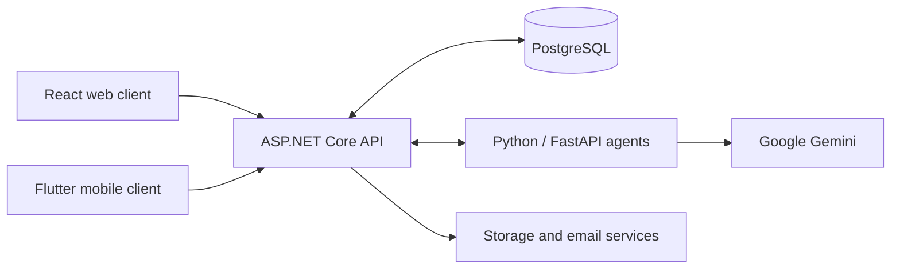
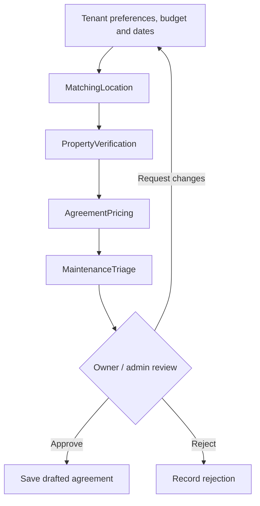

<div align="center">

# 🏡 RentWise

### Find a home. Manage a rental. Keep everyone connected.

A property rental platform with a React web app, Flutter mobile app, and an approval-driven AI rental workflow.


**SE3090 · Software Engineering Frameworks · Year 3, Semester 1**

[Features](#features) · [Architecture](#architecture) · [Local setup](#local-setup) · [Testing](#testing) · [Documentation](#documentation)

</div>

---

## Overview

RentWise brings property discovery, owner listings, rental agreements, payments and maintenance requests into one project. Tenants can search for a home and prepare a rental proposal, owners manage their properties and requests, and administrators review listings and platform activity.

The AI service supports matching, verification, agreement preparation and maintenance tasks. ASP.NET Core owns application permissions, persisted workflow state and approval decisions.

## Features

| For tenants | For property owners | For administrators |
| --- | --- | --- |
| Search by location, budget and bedrooms | Create and update property listings | Review property documents and listings |
| AI-assisted property discovery | Submit ownership proof and listing fees | Manually review verification issues |
| Save properties for later | Manage tenant inquiries and bookings | Manage users and listing status |
| Submit rental preparation requests | Review AI-prepared rental proposals | Review agreements and requests |
| View agreements and payment records | Maintain bank details for transfers | Inspect workflow progress and decisions |
| Report and track maintenance issues | Manage maintenance requests | Monitor platform activity |

**Web and mobile:** React and Flutter provide separate interfaces backed by the same ASP.NET API. Saved properties are currently stored locally per client; they do not sync between devices.

## Architecture



This is the intended client boundary and the path used by the setup below: clients call ASP.NET Core, which calls the internal Python service. Database credentials and internal service keys belong on the server.

> **Development configuration:** the current Vite config also contains a legacy `/api/agentic` proxy directly to Python. Set `VITE_API_URL=http://localhost:5174/api` as shown below to send web requests through ASP.NET Core instead. Do not use that direct proxy as the intended architecture.

### Rental concierge workflow



Each step consumes the previous saved output. ASP.NET loads and validates shared state, passes a snapshot to Python, and saves the result in PostgreSQL before advancing.

- **MatchingLocation:** selects an eligible property for the request.
- **PropertyVerification:** checks the selected listing's eligibility; this step is not a new document scan.
- **AgreementPricing:** prepares terms grounded in the selected property's rent and lease dates.
- **MaintenanceTriage:** suggests handover checks, without claiming an inspection took place.

Approval creates a **drafted agreement**, not an active tenancy or a payment. The workflow uses a deterministic four-step coordinator with bounded, read-only agent tools. See the [workflow design](RentWise-Backend/RENTAL_WORKFLOWS.md) for validation, retries and audit history.

## Technology

| Layer | Tools |
| --- | --- |
| Web | React, Vite, Tailwind CSS, React Router, TanStack Query |
| Forms | React Hook Form, Zod |
| Mobile | Flutter, Dart, Riverpod |
| Backend | ASP.NET Core 8, Entity Framework Core, JWT authentication |
| Database | PostgreSQL |
| Agent service | Python, FastAPI, LangChain, LangGraph, Google Gemini |
| Automation | GitHub Actions |

## Repository layout

```text
RentWise-Frontend/       React web application
RentWise-Mobile/         Flutter mobile application
RentWise-Backend/        ASP.NET Core API and EF Core migrations
RentWise-AgenticService/ Python agents and FastAPI endpoints
tests/                  Backend checks, performance and browser utilities
.github/workflows/      CI and deployment workflows
TESTING_EVIDENCE_GUIDE.md
ARCHITECTURE_REVIEW.md
```

## Local setup

### Prerequisites

- Node.js 24 and npm
- .NET 8 SDK
- Python 3.12 with a virtual environment
- PostgreSQL and a dedicated development database
- Flutter SDK with the target platform tooling
- Google model credentials for live AI calls

Commands below use PowerShell. Run the services in separate terminals.

### 1. Clone the repository

```powershell
git clone https://github.com/TharushaAkash/rentwise-property-rental.git
cd rentwise-property-rental
```

### 2. Configure the services

Use local environment variables or development secrets. Never commit actual credentials.

| Service | Configuration |
| --- | --- |
| ASP.NET | `ConnectionStrings__DefaultConnection`, `Jwt__Key`, `Jwt__Issuer`, `Jwt__Audience` |
| ASP.NET → Python | `AgenticServiceUrl=http://localhost:8000`, `AGENT_WORKFLOW_KEY` |
| Python | `GOOGLE_API_KEY`, matching `AGENT_WORKFLOW_KEY` |
| Python → ASP.NET | `BACKEND_API_URL=http://localhost:5174`, `BACKEND_API_KEY` matching the backend's `AgenticServiceApiKey` |
| React | `VITE_API_URL=http://localhost:5174/api` |
| Flutter | `API_BASE_URL` supplied with `--dart-define` |

Storage and password-reset email need additional Supabase/SMTP settings. Refer to [backend environment examples](RentWise-Backend/.env.example) and [password-reset setup](RentWise-Backend/PASSWORD_RESET.md). Environment examples do not replace the ASP.NET database/JWT configuration above.

### 3. Start the Python service

```powershell
cd RentWise-AgenticService
py -3.12 -m venv .venv
.\.venv\Scripts\python.exe -m pip install -r requirements.txt
.\.venv\Scripts\python.exe -m uvicorn main:app --reload --port 8000
```

Set the required Python environment values before starting the service.

### 4. Start the ASP.NET API

```powershell
cd RentWise-Backend
dotnet restore
dotnet run --launch-profile http
```

The HTTP profile uses **http://localhost:5174**. Development Swagger is available at **http://localhost:5174/swagger**. Backend startup applies EF Core migrations; verify the configured database is your intended development database first.

### 5. Start the React app

```powershell
cd RentWise-Frontend
npm ci
$env:VITE_API_URL = 'http://localhost:5174/api'
npm run dev
```

Open the local URL printed by Vite. You can also put `VITE_API_URL` in the frontend's ignored `.env.local` file.

### 6. Run the mobile app

For an Android emulator connected to the local API:

```powershell
cd RentWise-Mobile
flutter pub get
flutter run --dart-define=API_BASE_URL=http://10.0.2.2:5174/api
```

A physical phone needs the computer's reachable LAN address and a backend listening on that interface. For deployed builds, use the HTTPS API URL. See [mobile setup](RentWise-Mobile/README.md) for connectivity and cross-client workflow checks.

## Testing

Run these from the repository root after installing dependencies:

| Check | Command |
| --- | --- |
| React tests | `npm --prefix RentWise-Frontend test` |
| React production build | `npm --prefix RentWise-Frontend run build` |
| React lint | `npm --prefix RentWise-Frontend run lint` |
| Backend build | `dotnet build RentWise-Backend/RentWise.API.csproj` |
| Workflow and approval checks | `dotnet run --project tests/RentalWorkflows/RentalWorkflows.Tests.csproj` |
| Internal API-key checks | `dotnet run --project tests/ApiKeyMiddleware/ApiKeyMiddleware.Tests.csproj` |

Python tests:

```powershell
Push-Location RentWise-AgenticService
.\.venv\Scripts\python.exe -m unittest discover -s tests -v
Pop-Location
```

Flutter checks:

```powershell
Push-Location RentWise-Mobile
flutter analyze
flutter test
Pop-Location
```

Python unit tests use controlled model responses. They cover invalid outputs, unauthorized tools and prompt-injection attempts, but do not establish live model quality. The workflow backend suite uses in-memory SQLite unless configured for an isolated PostgreSQL test database. Never point it at application data.

For PostgreSQL integration, live end-to-end flows, performance measurements and screenshots, follow the [testing evidence guide](TESTING_EVIDENCE_GUIDE.md). Record actual results and limitations rather than treating mocked tests as deployed-system evidence.

## Documentation

| Guide | Purpose |
| --- | --- |
| [Rental workflows](RentWise-Backend/RENTAL_WORKFLOWS.md) | Shared state, agent contracts, review, retries and rollout |
| [Mobile application](RentWise-Mobile/README.md) | Flutter setup and cross-client workflows |
| [Agent tests](RentWise-AgenticService/tests/README.md) | Controlled AI checks and live smoke testing |
| [Testing evidence](TESTING_EVIDENCE_GUIDE.md) | Reproducible testing steps and evidence collection |
| [Architecture review](ARCHITECTURE_REVIEW.md) | Architecture findings and implementation notes |
| [Password reset](RentWise-Backend/PASSWORD_RESET.md) | Email delivery and reset configuration |

---

<div align="center">

**RentWise · SE3090 university project**

Built around shared application state, reviewable AI outputs and human approval.

</div>
