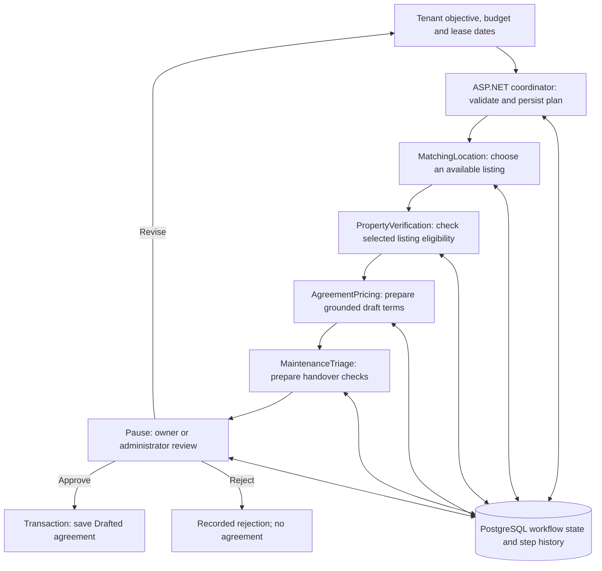

# Durable rental workflow

The React **Rental workflows** page (`/rental-workflows`) adds a separate rental preparation flow. Existing search, document verification, agreement and maintenance endpoints remain compatible. Flutter is intentionally not changed.

## Flow and ownership



Arrows to PostgreSQL are mediated by ASP.NET and EF Core. Python does not connect directly to the application database. Each `/advance` request loads the stored state, claims the next step with an optimistic concurrency token, passes the previous outputs to the internal Python role, validates its result, then saves it before the next step can run. React automatically advances remaining steps after **Run remaining steps**; closing the page leaves persisted progress available for recovery.

The domain-specific coordinator creates a deterministic four-step plan from the validated rental preparation request. It is custom orchestration, not the old placeholder LangGraph chain. This deliberately keeps existing standalone graphs working.

| Role | Input dependency | Only permitted tool | Structured result |
|---|---|---|---|
| MatchingLocation | Objective, budget, dates, eligible candidates | `search_available_properties` | Property ID and matching summary |
| PropertyVerification | Matching output and selected listing | `check_selected_property` | Same property ID, eligibility and explanation |
| AgreementPricing | Verification output, listing rent and requested dates | `read_verified_terms` | Same property ID, exact monthly rent, proposed terms and summary |
| MaintenanceTriage | Agreement output and selected listing | `read_agreement_handover` | Same property ID, proposed handover checklist and summary |

These are specialized implementations for rental preparation in `agents/rental_workflow.py`. They have different contracts, prompts and tools. Existing document OCR and incident triage implementations remain in their existing paths. Rental verification checks authoritative listing status and eligibility; it **does not claim a new document inspection**. Maintenance produces suggested handover checks, **not observed defects or dispatches**. Matching considers at most 50 available listings ordered by rent, and does not promise verified commute distances.

## Persistence and controls

- `AgentWorkflowRuns` holds the requester/reviewer/property/agreement references, objective, status, version and serialized structured state. State includes the plan, completed outputs, approval state, errors, retry count and decision history.
- `AgentWorkflowSteps` records input, output, allow-listed tool result, validation result, attempt number and start/finish timestamps. No hidden model reasoning or API credentials are stored.
- A role has one read-only snapshot tool, accepts no tool arguments, and cannot choose a URL, write records, activate tenancy or send messages. Two bounded model calls perform tool selection and structured output; provider retries are disabled and each call has a 40-second timeout. ASP.NET uses its existing 120-second client timeout.
- Independent Python and C# checks reject unknown property IDs, changed IDs, invalid schemas, non-active listings, inconsistent rent, unavailable dates, out-of-budget rent and malformed handover outputs. Free-text terms still require human review.
- Only the initiating tenant advances/revises. Only the selected property's owner or an administrator can decide; the requester cannot approve their own request. Unrelated users cannot view it.
- **Approval action:** create a persistent financial agreement record in `Drafted` status with the displayed terms, authoritative parties/rent and explicit dates. No agreement is created before approval. Deposit is zero until separately negotiated. This flow never activates tenancy, collects money or dispatches maintenance.
- Approval revalidates listing availability, ownership, rent, dates and all stored outputs. A serializable transaction saves the agreement and approval history together. A version check rejects stale/double decisions.
- Failures are persisted; three attempts per step are allowed. An interrupted read-only step may be recovered after its three-minute execution lease expires. A requested revision invalidates previous outputs and reruns the chain while retaining its audit history.

## Configuration and rollout

1. Apply migration `20260927104551_AddDurableRentalWorkflows` to the intended application database using your normal deployment process. It only adds nullable references, state/audit columns and indexes; it removes no existing data. Existing backend startup also calls `MigrateAsync`.
2. Set **the same randomly generated secret** as `AGENT_WORKFLOW_KEY` in the ASP.NET and Python service environments. Do not put it in React, source control or requests from a browser. ASP.NET also accepts configuration `AgentWorkflowKey`.
3. Keep `AgenticServiceUrl` configured on ASP.NET. Python continues using its configured Google model credentials; optional `RENTAL_WORKFLOW_MODEL` defaults to the same model name currently used by existing agents.
4. Deploy/restart Python first (new `/internal/rental-step` route), then the backend and frontend. Old features do not require the new key; the new workflow fails safely if the key/service is unavailable.

No production database or deployed service is changed by adding this implementation. Configure production secrets separately even if local `.env` files are configured.

## API

All routes below require JWT authentication and go through ASP.NET:

| Method / route | Purpose |
|---|---|
| `POST /api/rental-workflows` | Tenant starts an objective with `maxMonthlyRent`, `startDate`, `endDate` |
| `GET /api/rental-workflows` | Latest 100 authorized workflows |
| `GET /api/rental-workflows/{id}` | Persisted state, execution history and allowed UI actions |
| `POST /api/rental-workflows/{id}/advance` | Execute/recover the next read-only role |
| `POST /api/rental-workflows/{id}/decision` | Owner/admin sends `decision`, `note`, and displayed `version` |
| `POST /api/rental-workflows/{id}/revise` | Tenant replaces request after `RevisionRequested` |

`decision` is `approve`, `reject` or `revise`. Rejection/revision require an explanatory note.

## Verification and demo

From the repository root:

```powershell
dotnet run --project tests/RentalWorkflows
cd RentWise-AgenticService
.venv/Scripts/python.exe -m unittest discover -s tests -p test_rental_workflow.py -v
```

The C# executable tests the real EF persistence/service/controller logic with controlled agent responses. To test PostgreSQL migrations, set `RENTWISE_WORKFLOW_TEST_DB` to a **new disposable** database named `rentwise_workflow_test_*` and run the same executable. Never use the application database. It applies migrations and creates fixtures; it does not delete your database. PostgreSQL tests require a fresh database on every run.

Python tests use a controlled model and verify the chain, required tools, output schemas, injection attempts to select unknown IDs or write tools, eligibility, price consistency and internal-route authentication. These tests do not establish live model quality. Evaluate real objectives and review the saved evidence before the assessment.

Verification on 2026-09-27: 40 C# checks passed on SQLite and again on an isolated PostgreSQL 18 database with the actual migrations; 10 Python checks passed; backend and React builds passed. `tests/live_rental_smoke.py` also completed all four roles against the configured real model using synthetic listing data, without creating business records. Browser interaction and a deployed full-stack run have not been verified. Local ignored `.env` files were configured with a shared workflow key; deployed environments still require their own configuration and rollout.

Demo: log in as a tenant, create a workflow, run its steps, then open the same reference as its owner/admin, review the agent results, request a revision or approve, and return to the tenant's page and refresh. Show PostgreSQL state and the saved draft/history. Test rejection and a failed step as well.

**Assignment gap intentionally left:** Section 10 requires starting in one client and approving in the other. This change provides the React flow and shared API, but does not complete the Flutter part. Draft creation is the defined approval-gated action; explain that scope clearly in the demo. Keep each contributor's AI usage log and verify their understanding of their role.
